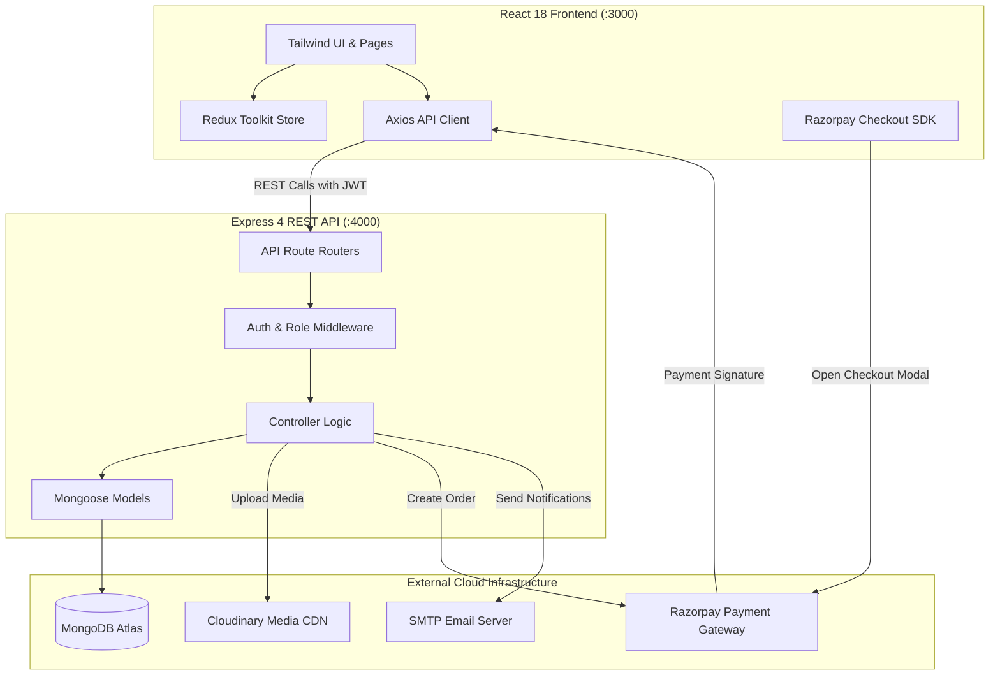

# StudyNotion — Full-Stack EdTech Platform

> An end-to-end, full-stack educational technology web application enabling students to discover, purchase, and consume interactive courses, while empowering instructors to create curricula, manage multimedia content, and track student enrollment analytics.

[](https://react.dev/)
[](https://nodejs.org/)
[](https://expressjs.com/)
[](https://www.mongodb.com/atlas)
[](https://tailwindcss.com/)
[](https://redux-toolkit.js.org/)
[](https://cloudinary.com/)
[](https://razorpay.com/)

---

## Table of Contents
- [1. Project Overview](#1-project-overview)
- [2. Problem Statement & Objectives](#2-problem-statement--objectives)
- [3. Key Features](#3-key-features)
- [4. Technology Stack](#4-technology-stack)
- [5. System Architecture](#5-system-architecture)
- [6. Repository Structure](#6-repository-structure)
- [7. Getting Started](#7-getting-started)
- [8. Environment Variables](#8-environment-variables)
- [9. MongoDB Atlas Setup](#9-mongodb-atlas-setup)
- [10. Running the Application](#10-running-the-application)
- [11. Course Creation & Catalog Workflows](#11-course-creation--catalog-workflows)
- [12. Razorpay Test Mode Payments](#12-razorpay-test-mode-payments)
- [13. Security Best Practices](#13-security-best-practices)
- [14. Known Limitations](#14-known-limitations)
- [15. Future Roadmap](#15-future-roadmap)
- [16. Portfolio & Resume Summary](#16-portfolio--resume-summary)

---

## 1. Project Overview

**StudyNotion** is a production-style, monolithic MERN-stack web application designed to democratize online learning. It bridges the gap between students seeking structured programming education and content creators seeking a frictionless course authoring and monetization pipeline.

The platform provides a responsive user experience with fine-grained role-based access control (Student, Instructor, and Admin), dynamic course filtering, multimedia lecture streaming, cart checkout integration, and detailed instructor dashboards.

---

## 2. Problem Statement & Objectives

### The Problem
Traditional online learning portals are often fragmented: video hosting is disconnected from payment collection, course authoring tools are cumbersome, and navigation structures obscure courses behind rigid category gates.

### Project Objectives
1. **Unified Learning Workflow:** Seamless transition from browsing catalog courses to instant checkout, curriculum progression, and lecture reviews.
2. **Robust Multi-Step Authoring:** Provide instructors with an intuitive multi-step builder (metadata, syllabus sections, lecture video uploads, and draft/publish toggling).
3. **Secure Transaction Processing:** Deliver end-to-end payment capture and server-side HMAC signature verification using Razorpay.
4. **Resilient Cloud Media Management:** Automate thumbnail and video delivery via Cloudinary with on-the-fly streaming support.

---

## 3. Key Features

### For Students
* **Authentication & Recovery:** JWT-based signup with email OTP verification, cookie/header bearer token storage, and secure password reset tokens.
* **Course Discovery:** Interactive Catalog dropdown with topic filtering, Swiper-powered course sliders, star ratings, and detailed syllabi.
* **Cart & Checkout:** Multi-course shopping cart with live total aggregation and direct checkout via Razorpay Test Gateway.
* **Video Learning Interface:** Built-in video player (`video-react`) with sidebar navigation, lecture completion toggling, and course progress bars.
* **Ratings & Testimonials:** Post-enrollment course reviews and multi-course ratings aggregated on the homepage review slider.

### For Instructors
* **Multi-Step Course Builder:**
  * **Step 1 (Information):** Title, description, pricing, dynamic category selection, chip tag entry, requirements manager, and thumbnail uploader.
  * **Step 2 (Content Builder):** Hierarchical Section and Subsection management with video lecture uploads.
  * **Step 3 (Publish):** Course status control (`Draft` vs. `Published`).
* **Instructor Dashboard:** Visual chart analytics (`chart.js`) breaking down total enrolled students and total earnings generated.
* **Course Inventory:** Table of authored courses with status indicators, pricing, duration, and deletion options.

### General & Platform
* **Role-Based Routing:** Route guards enforcing authorization boundaries (`isStudent`, `isInstructor`, `isAdmin`).
* **Profile Management:** Avatar image replacement via Cloudinary, bio updates, and profile deletion.
* **Contact & Inquiries:** Contact-us form dispatching automated email notifications via Nodemailer.

---

## 4. Technology Stack

| Layer | Technologies Used |
| :--- | :--- |
| **Frontend** | React 18 (`react-scripts` 5.0), Tailwind CSS 3.2, Redux Toolkit, React Router v6, Axios |
| **UI Components** | React Icons, Swiper 8, React Dropzone, Video-React, React Hot Toast, Chart.js |
| **Backend** | Node.js, Express.js 4.19, Cookie-Parser, CORS, Express-FileUpload |
| **Database** | MongoDB Atlas, Mongoose 8.2 ODM |
| **Authentication** | JSON Web Tokens (JWT), Bcrypt password hashing, Crypto Random String |
| **Cloud Storage** | Cloudinary v2 (Media asset and video storage) |
| **Payment Gateway** | Razorpay SDK (Order generation and HMAC-SHA256 signature verification) |
| **Email Service** | Nodemailer (SMTP transport for OTPs and enrollment receipts) |

---

## 5. System Architecture

The application adopts a decoupled client-server architecture with cloud-managed database and asset services:



---

## 6. Repository Structure

```text
StudyNotion/
├── public/                 # Static assets & index.html
├── src/                    # Frontend React source code
│   ├── assets/             # Logos, banner media, branding assets
│   ├── components/         # Modular UI components
│   │   ├── Common/         # Navbar, Footer, ReviewSlider, RatingStars
│   │   └── core/           # Auth forms, AddCourse builder, Course views, Dashboard
│   ├── data/               # Static navigation and footer links
│   ├── hooks/              # Custom React hooks (e.g. useOnClickOutside)
│   ├── pages/              # View pages (Home, Catalog, CourseDetails, Dashboard)
│   ├── reducer/            # Redux combined root reducer
│   ├── services/           # Backend API connector and operation dispatches
│   ├── slices/             # Redux state slices (auth, course, cart, profile)
│   └── utils/              # Client constants and helper utilities
├── SERVER/                 # Backend Node.js / Express service
│   ├── config/             # Cloudinary, Database, and Razorpay configurations
│   ├── controllers/        # Business logic controllers
│   ├── mail/               # HTML email templates
│   ├── middleware/         # JWT verification and role guards
│   ├── models/             # Mongoose schemas (User, Course, Category, etc.)
│   ├── routes/             # API route definitions
│   └── utils/              # Helper utilities (imageUploader, mailSender)
├── docs/                   # Developer documentation guides
│   ├── PROJECT_STRUCTURE.md# Detailed file-by-file breakdown
│   └── DEVELOPMENT.md      # Setup, debugging, and troubleshooting guide
├── .env                    # Root environment configuration
├── package.json            # Root scripts and frontend dependencies
└── tailwind.config.js      # Custom theme palettes and typography
```

For an exhaustive breakdown of individual files and their responsibilities, refer to [`docs/PROJECT_STRUCTURE.md`](docs/PROJECT_STRUCTURE.md).

---

## 7. Getting Started

### Prerequisites
* **Node.js**: `v18.x` or higher
* **npm**: `v9.x` or higher
* **MongoDB Atlas** database cluster (or local MongoDB)
* **Cloudinary** account for file storage
* **Razorpay** test mode account

### Installation

1. **Clone the repository:**
   ```bash
   git clone <repository_url>
   cd StudyNotion
   ```

2. **Install root & frontend dependencies:**
   ```bash
   npm install
   ```

3. **Install backend dependencies:**
   ```bash
   cd SERVER
   npm install
   cd ..
   ```

---

## 8. Environment Variables

Create `.env` in the project root and an identical `.env` in the `SERVER/` directory.

```env
# ==========================================
# Frontend Configuration (Root .env)
# ==========================================
REACT_APP_BASE_URL=http://localhost:4000/api/v1
REACT_APP_RAZORPAY_KEY=rzp_test_YOUR_KEY_ID

# ==========================================
# Backend Configuration (Root & SERVER/.env)
# ==========================================
PORT=4000
MONGO_URI=mongodb+srv://<username>:<password>@cluster.mongodb.net/StudyNotion?retryWrites=true&w=majority
JWT_SECRET=your_jwt_secret_passphrase
FOLDER_NAME=StudyNotion

# Cloudinary Media Storage
CLOUD_NAME=your_cloudinary_cloud_name
API_KEY=your_cloudinary_api_key
API_SECRET=your_cloudinary_api_secret

# Razorpay Payment Gateway (Test Mode)
RAZORPAY_KEY=rzp_test_YOUR_KEY_ID
RAZORPAY_SECRET=your_razorpay_secret_key

# Nodemailer SMTP Email
MAIL_HOST=smtp.gmail.com
MAIL_USER=your_email@gmail.com
MAIL_PASS=your_gmail_app_password
```

> [!NOTE]
> Detailed descriptions of every variable and its usage are available in [`docs/DEVELOPMENT.md`](docs/DEVELOPMENT.md).

---

## 9. MongoDB Atlas Setup

1. Log in to [MongoDB Atlas](https://www.mongodb.com/atlas) and create a free tier (M0) cluster.
2. Under **Security > Database Access**, create a user with read/write privileges.
3. Under **Security > Network Access**, add your current IP address (or `0.0.0.0/0` to allow access from any development IP).
4. Under **Database > Connect**, choose **Drivers** (Node.js) and copy the connection string.
5. Replace `<password>` with your database user password and specify the database name (`/StudyNotion`).
6. Assign the connection string to `MONGO_URI` in your `.env` files.

---

## 10. Running the Application

### Option A: Concurrent Execution (Recommended)
Start both frontend and backend concurrently from the root directory:
```bash
npm run dev
```
* **Frontend:** `http://localhost:3000`
* **Backend API:** `http://localhost:4000`

### Option B: Individual Terminals

* **Start Backend Server:**
  ```bash
  cd SERVER
  npm run dev
  ```

* **Start Frontend Client:**
  ```bash
  npm start
  ```

---

## 11. Course Creation & Catalog Workflows

### Creating a Course (Instructor Account)
1. Sign up or log in as an **Instructor**.
2. Navigate to **Dashboard > Add Course** (`http://localhost:3000/dashboard/add-course`).
3. **Step 1 (Information):**
   * Enter Course Title, Description, and Price.
   * Choose a Category from the dropdown.
   * Add Tags using the chip input (press <kbd>Enter</kbd> or comma).
   * Drag and drop or browse for a Course Thumbnail (`.png`, `.jpg`, `.webp`).
   * Enter course benefits and type requirements/instructions (press <kbd>Enter</kbd> or click **Add**).
   * Click **Next**.
4. **Step 2 (Course Builder):**
   * Create course sections (e.g., "Module 1: Foundations").
   * Add lectures/subsections with video files and titles.
   * Click **Next**.
5. **Step 3 (Publish):**
   * Select **Public** status and click **Save and Publish**.

### Testing the Catalog
1. Click **Catalog** in the top navigation bar.
2. The dynamic dropdown lists all categories.
3. Select any category (e.g. *Web Development*) to open the catalog page with courses filtered by category.

---

## 12. Razorpay Test Mode Payments

1. Ensure `REACT_APP_RAZORPAY_KEY` and `RAZORPAY_KEY` contain a valid `rzp_test_...` key.
2. Log in with a **Student** account (`accountType: "Student"`).
3. Browse to any published course (e.g. `http://localhost:3000/courses/<course_id>`).
4. Click **Buy Now**.
5. The Razorpay checkout modal will load in **Test Mode**.
6. Select **Netbanking** > Choose any bank > Click **Pay**.
7. In the Razorpay test simulator modal, click **Success**.
8. The client sends payment details to `/api/v1/payment/verifyPayment`.
9. The backend verifies the HMAC signature using `RAZORPAY_SECRET`, enrolls the student, and redirects to **Dashboard > Enrolled Courses**.

---

## 13. Security Best Practices

* **Zero Secret Exposure:** Never commit `.env` files. Both root `.env` and `SERVER/.env` are registered in `.gitignore`.
* **Public vs. Private Keys:** Only the Razorpay Key ID (`rzp_test_...`) is shared with the client. The `RAZORPAY_SECRET` is strictly kept on the server for signature verification.
* **Server-Side Authorization:** Every critical mutation (order capture, lecture uploads, course modifications) is guarded by `auth`, `isStudent`, or `isInstructor` middleware verifying signed JWTs.
* **Database Injection Prevention:** Mongoose schema modeling and sanitized queries prevent NoSQL injection attacks.

---

## 14. Known Limitations

* **Video Streaming:** Video assets are served directly via Cloudinary CDN URLs rather than chunked HLS adaptive bitrate streaming.
* **Email Rate Limits:** Free SMTP tiers (e.g., personal Gmail accounts) enforce daily message quotas.
* **Payment Refund Webhooks:** Live refund webhooks and subscription billing models are not included; payments use one-time order capture.

---

## 15. Future Roadmap

- [ ] **Adaptive Video Streaming:** Implement HLS/DASH transcoding for bandwidth-adaptive video playback.
- [ ] **Live Quizzes & Coding Sandbox:** In-browser code execution playground for programming exercises.
- [ ] **Real-Time Messaging:** Socket.io discussion rooms between instructors and enrolled students.
- [ ] **Certificate Generation:** Automated PDF certificate issuance upon completing 100% of course lectures.

---

## 16. Portfolio & Resume Summary

```text
StudyNotion — Full-Stack Educational Technology Platform
Technologies: React 18, Node.js, Express, MongoDB Atlas, Redux Toolkit, Tailwind CSS, Razorpay, Cloudinary
```

* Engineered a full-stack e-learning web application supporting role-based access control (Student, Instructor, Admin) for over 10 distinct technical categories.
* Implemented a multi-step course authoring engine with drag-and-drop media uploading via Cloudinary and hierarchical section/lecture management.
* Integrated Razorpay payment gateway in test mode with server-side HMAC-SHA256 signature verification, ensuring zero course assignment without verified payment capture.
* Built state management using Redux Toolkit to handle persistent cart sessions, authentication tokens, course building steps, and lecture progress tracking.
* Designed a responsive UI with Tailwind CSS, custom Swiper sliders, real-time toast notifications, and interactive analytics dashboards using Chart.js.
